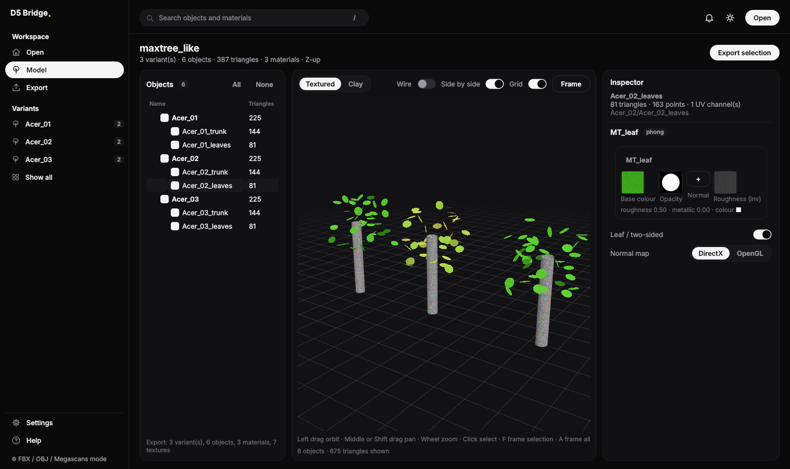

# D5 Bridge: 3ds Max / MaxTree / Megascans to D5 Render

D5 Bridge is a Windows desktop tool. It opens **3ds Max scenes (Corona or V-Ray)**,
**Megascans / Fab downloads** and plain **FBX / OBJ** files, and shows them with
their textures. You choose which tree variants and objects you want, and it
exports a **clean FBX plus a D5-ready textures folder**. Files get smaller,
but geometry detail and texture resolution are not reduced.



```
 .max (MaxTree, Corona/V-Ray) ─┐                    ┌─> Acer_01.fbx ┐
 Megascans / Fab folder ───────┼─> preview + pick ──┼─> Acer_02.fbx ├─ textures/ (shared, full-res)
 FBX / OBJ ────────────────────┘   variants/objects └─> Acer_03.fbx ┘  d5_materials.json, report
```

---

## 1. The problem

| Pain point | Why it happens | What D5 Bridge does |
| --- | --- | --- |
| `.max` cannot be opened outside 3ds Max | `.max` is a closed binary format (OLE container holding plug-in data). Corona and V-Ray materials are stored as plug-in data that only those plug-ins can decode. | Runs **your own 3ds Max** in the background (`3dsmaxbatch.exe`, no UI) with a Python exporter, or from a toolbar button inside Max. |
| Corona / V-Ray materials arrive in D5 grey or broken | The FBX exporter only understands Standard and Physical materials. Corona Physical, CoronaLegacy, VRayMtl, 2-Sided and Blend materials are dropped to a default. | Each material is converted to metal/roughness PBR **before** export: base colour, opacity, normal, bump, roughness, metallic, AO, translucency, emissive. |
| Leaves show as black or white squares | Opacity lives in a separate map that D5 does not pick up from FBX. | Opacity is packed into the **base-colour alpha** (D5 detects cut-outs from it) and written as `*_Opacity`. Leaf materials are flagged two-sided / Foliage. |
| Bumps look inverted, surfaces too shiny | Corona/V-Ray use **glossiness**, D5 uses **roughness**. Megascans normals are OpenGL-style, D5 expects DirectX. | Gloss maps are inverted exactly (`255 - v`). The normal-map green channel is flipped when needed. Both conversions are bit-exact. |
| Colour-correct, Mix and Falloff maps vanish | Procedural maps are evaluated by the renderer, and FBX can't store them. | They are **baked** to images at the source bitmap's resolution inside 3ds Max (`renderMap`). |
| One file holds 3-6 tree versions | MaxTree ships variants side by side (or hidden), as groups or layers. | Variants are detected from groups, layers, selection sets, positions or names. Each can become its own FBX. |
| Huge files | Repeated textures, TIFF/TGA sources, grey maps saved as RGB, opaque alpha channels, duplicated per-corner data. | Lossless clean-up (section 4). Nothing is decimated or downscaled. |

---

## 2. Architecture

```
d5bridge/
  d5bridge/
    scene.py           shared scene model (n-gons, indexed normals/UVs, PBR materials)
    fbx/binary.py      FBX binary reader/writer (7.x) + ASCII reader
    fbx/reader.py      FBX -> Scene (full pivot/pre-rotation/geometric-offset transform stack)
    fbx/writer.py      Scene -> FBX 7.4 binary (instancing, IndexToDirect, zlib arrays)
    io/obj_reader.py   OBJ + MTL
    io/megascans.py    Bridge / Fab folders: VarN, LODs, Atlas textures, json metadata
    io/max_bundle.py   loads what the 3ds Max exporter produced
    max/bridge.py      finds 3ds Max (registry / Program Files) and runs 3dsmaxbatch.exe
    materials.py       texture-channel detection from file names and FBX slots
    variants.py        automatic variant detection
    optimize/mesh.py   lossless geometry optimisation
    optimize/textures.py lossless texture optimisation + exact conversions
    pipeline.py        export: selection -> optimise -> textures -> FBX -> report
    gui/               PySide6 app (theme, OpenGL viewport, pages)
    cli.py             batch conversion
  max_plugin/
    d5bridge_max_export.py   runs INSIDE 3ds Max (pymxs): material conversion, baking, FBX
    d5bridge_max_panel.py    in-Max panel (variants, material check, send to app)
    d5bridge_batch.ms        3dsmaxbatch entry point
    D5Bridge.mcr             toolbar macro
    install_max_plugin.bat   copies the scripts into every installed 3ds Max
  packaging/                 PyInstaller spec, Inno Setup installer, build script
  tests/                     round-trip, losslessness and loader tests
```

### How a `.max` file is opened

1. D5 Bridge finds `3dsmaxbatch.exe` (3ds Max 2021 or newer) and runs it with
   `d5bridge_batch.ms -sceneFile your.max`. No 3ds Max window appears.
2. Inside Max, `d5bridge_max_export.py`:
   - converts Corona / V-Ray proxies to meshes (optional) and warns about
     Forest Pack, RailClone and scatter objects
   - un-hides hidden objects, because MaxTree often hides the alternative variants
   - makes object and material names unique and file-safe
   - converts every material (including Multi/Sub-Object children) to a PBR description
   - bakes procedural maps to PNG at the resolution of the bitmap they wrap
   - records groups, layers and selection sets as variant hints
   - exports geometry with the Autodesk FBX exporter (modifiers collapsed,
     TurboSmooth baked into the mesh, instances kept)
3. The app loads the resulting `scene.fbx` and `manifest.json`. It re-links
   textures even when the stored paths came from another PC, using the Asset
   Tracker list and the folders next to the `.max` file.

Open a file once and the bundle is cached. Reopening it is instant until the
`.max` changes.

**Without 3ds Max:** FBX, OBJ and Megascans work fully. For `.max` files, use
the **D5 Bridge toolbar button** on a machine that has 3ds Max. Or export to
FBX there and open that FBX here: textures are matched by file name, and gloss
maps are found from their names.

**Renderer not installed:** if Corona or V-Ray is missing on the PC, 3ds Max
loads their materials as *Missing* placeholders. D5 Bridge then matches the
file's bitmaps to materials by name and lists this under Warnings.

---

## 3. Material conversion

| 3ds Max material | Read as |
| --- | --- |
| CoronaPhysicalMtl | base colour/map, roughness (or glossiness mode, inverted), metalness, base bump/normal, opacity, translucency (colour/fraction), thin mode (two-sided), self-illumination, displacement (kept as a file) |
| CoronaLegacyMtl / CoronaMtl | diffuse (x level), reflection glossiness (inverted to roughness), opacity, bump, translucency, self-illumination |
| VRayMtl | diffuse, reflection glossiness (or roughness mode), metalness, opacity, bump (x multiplier), translucency, self-illumination |
| VRay2SidedMtl | front material + translucency, marked two-sided |
| VRayBlendMtl, CoronaLayeredMtl, VRayOverrideMtl, Shell, CoronaRaySwitch, Blend, DoubleSided | the base / front / direct material |
| Physical Material, Standard | all main slots |
| Multi/Sub-Object, VRayMultiSubMtl | every sub-material, per-face IDs kept |

| Map type | Handling |
| --- | --- |
| Bitmap, CoronaBitmap, VRayBitmap/VRayHDRI | file + tiling/offset + map channel, Output "invert", mono "alpha" output |
| Normal Bump, CoronaNormal, VRayNormalMap | normal map + strength + flip-green flag. An added bump map is kept as a separate Bump map |
| Output, Gamma, Color2Bump, BumpConverter | passed through to the map they wrap |
| Color Correction, Corona/V-Ray CC, Mix, CoronaMix, Falloff, CompTex, MultiMap, Composite, tint, Noise, Gradient... | baked at full resolution |

The FBX uses Phong materials, the type every FBX importer reads:
`DiffuseColor` (base colour, with opacity in alpha), `TransparentColor`
(opacity), `NormalMap`, `Bump`, `EmissiveColor`, `AmbientColor` (AO).
Roughness and Metalness textures are connected to PBR properties of the same
name. In some D5 versions these two, plus translucency, still need to be
dropped into their slots by hand. Every map is in `textures/` with a D5 suffix
(`_BaseColor`, `_Normal`, `_Roughness`, `_Metallic`, `_Opacity`, `_AO`,
`_Translucency`). `d5_materials.json` lists the template to use per material
(Foliage or Custom).

---

## 4. Reducing file size without losing detail

"Without losing detail" is taken literally. In the default **Lossless** mode
the exported model renders **bit-identical** geometry and **pixel-identical**
textures at the original resolution. The tests in `tests/` check this.

**Geometry**

- Positions are welded only when they are bitwise identical.
- Normals and UVs are stored as unique values plus an index (FBX
  `IndexToDirect`). Foliage cards usually have one normal per card, so this
  often halves the file.
- Zero-area and collapsed polygons are removed (they render nothing).
- Unused control points, empty, constant and duplicated UV channels, and
  unused material slots are removed.
- Identical meshes become instances (one geometry, many objects).
- FBX arrays are zlib-compressed (part of the FBX format, read by every
  importer).
- N-gons are kept. Triangulating would *add* data.

**Textures**

- Each distinct image is written once, even when it was saved under several
  names or formats. The check compares decoded pixels, not file bytes.
- TIFF, TGA, BMP and PSD files become maximally compressed PNG (lossless).
  When an original PNG is already smaller, it is kept as is.
- JPEGs are copied byte for byte, because re-saving a JPEG always loses quality.
- A fully opaque alpha channel is dropped.
- Grey data saved as RGB (roughness, opacity, AO) is stored as one channel.
- 16-bit images that only hold 8-bit values (every value a multiple of 257)
  are stored as 8-bit. True 16-bit data is kept.
- A single-colour texture (often a 4K "spec" map of flat grey) becomes the
  equivalent material value.
- Variants share one `textures/` folder instead of copying it per FBX.

**Optional, not lossless:** *Visually lossless* saves colour maps without
alpha as JPEG quality 95 with 4:4:4 chroma. Data maps (normal, roughness,
opacity) stay lossless. Use it only when you need the smallest files. There
is also a max-texture-size option for previews and drafts. It is off by
default and not exposed in the UI.

What cannot be reduced losslessly: a mesh's real polygon count, or
high-frequency texture content. Those can only shrink by actually removing
detail, which is what this tool avoids.

---

## 5. Using it

### Install

- **Installer:** `D5BridgeSetup-1.0.0.exe`, built by
  `packaging/build_windows.bat` or by the GitHub Action
  *D5 Bridge (Windows build)*. It adds Start-menu entries, an **"Open in D5
  Bridge"** item on the right-click menu for `.max`, `.fbx` and folders, and
  can install the 3ds Max toolbar button.
- **From source:** Python 3.11+, then
  `pip install -r requirements.txt` and `python run_d5bridge.py`.

### 3ds Max toolbar button (optional)

Run `max_plugin/install_max_plugin.bat`. In 3ds Max go to **Customize >
Customize User Interface > Toolbars**, choose category **D5 Bridge**, and drag
**D5 Bridge** onto a toolbar. The panel lists variants (groups, then layers,
then root objects). It shows how each material will convert, can
select/isolate a variant in the viewport, and offers two actions:
**Open in D5 Bridge** (preview and export in the app) or **Quick export**
(straight to FBX with the last settings).

### Workflow in the app

1. **Open:** drop a `.max`, `.fbx`, `.obj`, a Megascans folder or a
   `manifest.json`.
2. **Model page:** the left list holds variants with their objects, each with
   a checkbox. Unticked items are hidden and not exported. In the centre view,
   left-drag orbits, middle or Shift-drag pans and the wheel zooms. Click
   selects, Ctrl-click adds to the selection, F frames the selection and A
   frames everything. **Side by side** spreads variants out for comparison
   (preview only). **Clay** and **Wire** help inspect geometry. The
   right-hand inspector shows every texture per material: click one to
   replace it, toggle leaf/two-sided, or switch the normal convention.
3. **Export page:** set the output folder, one FBX per variant or a single
   file, placement at the origin, texture mode and conversions. The report
   lists each saving and every warning.
4. **In D5:** Import > Model > the FBX. For leaves, choose the **Foliage**
   template if D5 picked another one. The opacity map is already in the
   base-colour alpha.

### Command line

```
D5BridgeCLI.exe --info tree.max
D5BridgeCLI.exe --export tree.max --out D:\D5\Library --split-variants
D5BridgeCLI.exe --export "D:\Megascans\Downloaded\3dplant\abc" --out D:\D5 --variants Var1,Var3 --lod 0
D5BridgeCLI.exe --export model.fbx --out D:\D5 --single-file --mode visually_lossless
```

---

## 6. Output layout

```
<out>/<asset>/
  Acer_01.fbx               one per variant (or <asset>.fbx)
  Acer_02.fbx
  textures/
    MT_leaf_BaseColor.png   RGBA: colour + leaf mask
    MT_leaf_Opacity.png
    MT_leaf_Normal.png      DirectX
    MT_leaf_Roughness.png   gloss already inverted
    MT_leaf_Translucency.png
    MT_bark_BaseColor.jpg   copied unchanged
  d5_materials.json         template hint, values and maps per material
  export_report.txt         sizes before/after, every conversion, warnings
```

---

## 7. Limits and notes

- 3ds Max 2021+ is needed for `.max` files (Python 3 / pymxs and
  `3dsmaxbatch.exe`), with the renderer the file was made for (Corona or
  V-Ray) for exact materials.
- Forest Pack, RailClone and scatter objects are not geometry. Convert them to
  Editable Poly first; the exporter lists them under warnings.
- Displacement maps are written as files but not connected, because D5 does
  not read displacement from FBX.
- Animation (wind), cameras and lights are not exported. D5 has its own
  foliage wind.
- The preview loads textures at up to 2048 px for speed. Exports always use
  the full resolution.

## 8. Development

```
pip install -r requirements-dev.txt
python -m pytest -q          # 18 tests: FBX round trip, assimp check, pixel-exact texture ops,
                             # variant detection, OBJ, Megascans, 3ds Max bundle loader
```
