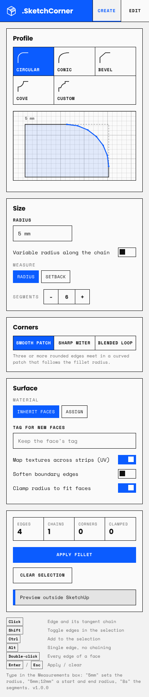
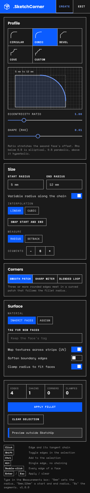

# .SketchCorner


Parametric fillets, chamfers, coves and custom-profile edges for SketchUp 2017+.
It has a live 3D preview, corner patches where several rounded edges meet, variable radius along a chain and non-destructive editing.
Every change is a single undo step named **.SketchCorner**.

| Light | Dark |
| --- | --- |
|  |  |

## Install

1. Download `release/SketchCorner-1.0.0.rbz`.
2. In SketchUp choose **Extensions > Extension Manager > Install Extension** and pick the `.rbz`.
3. Open **View > Toolbars > .SketchCorner**, or use **Extensions > .SketchCorner**.

## Use

| Action | What it does |
| --- | --- |
| Click an edge | Selects the edge and its tangent chain (cylinder rims, curved paths). |
| <kbd>Shift</kbd> + click | Toggles edges in the selection. |
| <kbd>Ctrl</kbd> + click | Adds edges to the selection. |
| <kbd>Alt</kbd> + click | Selects a single edge, with no chaining. |
| Double-click a face | Selects every crease edge of that face. |
| Measurements box | `5mm` sets the radius, `5mm;12mm` sets start and end radius, `8s` sets segments. |
| <kbd>Enter</kbd> / <kbd>Esc</kbd> | Applies / clears the selection. |

The preview draws the predicted geometry in blue: hard edges are thick, soft edges thin.
Edges whose radius would overrun a face turn red. With **Clamp radius** on, their radius is reduced to the largest value that fits; with it off, Apply is refused.

**Edit Fillet** loads a stored operation back into the panel from any `.SketchCorner` group.
From there you can **Update**, **Revert** (puts the original edges back) or **Bake** (drops the history).

## Features

| Area | Detail |
| --- | --- |
| Profiles | **Circular** (equal radius), **Conic** (eccentricity ratio between the two faces plus a rho shape factor), **Bevel** (chamfer, stepped, flat facets), **Cove** (inverse quarter round), **Custom** (any open polyline or arc picked in the model). |
| Variable radius | Start/end radius along each chain, linear or cubic (smoothstep). Closed loops run start, end, start. |
| Corners | At N-valence junctions: **Smooth patch** (spherical patch through the fillet centres), **Sharp miter** (crisp miter, flat hard facets where profiles differ), **Blended loop** (one soft quad loop plus a closing face). Two strips with matching profiles always meet on an exact miter. Tangent chains continue without a seam. |
| Topology | Closed, manifold output: every edge has two faces, wound consistently. A rebuilt face is checked for self-intersection and folding before anything is written. |
| History | Each operation is stored on its group (dictionary `SketchCorner`, key `ops`): parameters, edge node indices and a compressed snapshot of the original faces. |
| Materials and UV | Strips inherit the adjacent faces' materials, or take an assigned material, and can go on a chosen tag. Textures are unrolled across each strip from both sides and blended so they meet both neighbours without a seam. |
| Edge states | Internal strip and patch edges are soft and smooth. Tangent boundaries and end profiles stay hard (optional **Soften boundary edges**). Original soft edges, such as cylinder seams, keep their state after trimming. |

## Source layout

```
src/
  SketchCorner.rb              loader: registers the SketchupExtension
  SketchCorner/
    main.rb                    requires core, installs menu, toolbar, context menu
    core/
      engine.rb                geometric engine (pure Ruby): corner solver,
                               junctions and miters, strips, patches, clamping,
                               edge states
      tool.rb                  FilletTool, EditTool, ProfilePickTool, tangent
                               chaining, picking, OpenGL overlay, Commands.fillet
      parametric.rb            history records, regenerate / revert / bake,
                               remembered settings
      ui.rb                    HtmlDialog controller, menus and toolbar
      profiles.rb              unit profiles in triangle coordinates
      mesh.rb                  polygon mesh + fans around vertices (pure Ruby)
      uv.rb                    affine UV maps and strip unrolling (pure Ruby)
      vmath.rb                 vector math, triangulation (pure Ruby)
      bridge.rb                SketchUp faces <-> Mesh, writer
    html/                      dialog.html / .css / .js (SketchUp Tools UI Kit)
    icons/                     toolbar icons (SVG for Windows, PNG for macOS), logo
test/                          minitest suites; support/fake_sketchup.rb is an
                               in-memory double of the SketchUp API
tools/build_rbz.rb             packager
```

The engine, profiles, mesh, UV and vector modules don't touch the SketchUp API, so they are tested with plain Ruby.
`bridge.rb` is the only place that converts between SketchUp entities and the engine's mesh.

### How the engine works

1. **Edge frames.** For a selected edge with faces F1 and F2, `m1` and `m2` are the in-face directions pointing away from the edge, and `phi = angle(m1, m2)`. A radius R becomes the tangent offset `t = R / tan(phi / 2)`. Concave edges use the same formula, so they gain material instead of losing it.
2. **Offset meet.** Each face corner at an affected vertex moves to where the offset lines meet. If both of the corner's edges are rounded, it is the intersection of the two offset lines. If only one is, the corner slides along the other edge.
3. **Profiles in triangle coordinates.** A profile point is `apex + a(start - apex) + b(end - apex)`. Because this map is affine, one unit circle gives the exact cross-section and the exact sheared end cap. The apex sits on the edge line when both tangent points project to the same station along it. Otherwise it sits at the vertex: that is the cap or miter plane.
4. **Junctions.** The fan of faces around each vertex produces a closed ring of corner points and end profiles.
   * One rounded edge: the cap face absorbs the profile.
   * Matching profiles: they are merged, so the ring collapses into a miter.
   * Anything left over: the ring is closed by the chosen corner strategy.
5. **Clamping.** Per edge, slides must stay within the next edge (49% when both ends move) and strips must keep a positive length. If a face still folds, a global bisection on the radius scale finds the largest result that is valid.

## Build the .rbz

```sh
cd sketchcorner
ruby tools/build_rbz.rb        # -> release/SketchCorner-<version>.rbz
```

The script syntax-checks every Ruby file. It then writes a standard ZIP whose root holds `SketchCorner.rb` and `SketchCorner/`; that layout is all an `.rbz` is.
It uses only Ruby's bundled Zlib, so it runs the same on Windows, macOS and Linux.

To package by hand instead, zip the *contents* of `src/` (not the folder itself) and rename `.zip` to `.rbz`:

```sh
cd src && zip -r ../release/SketchCorner.rbz SketchCorner.rb SketchCorner
```

To raise the version, change `VERSION` in `src/SketchCorner.rb`.

## Test

```sh
cd sketchcorner
ruby -Isrc test/test_engine.rb       # geometry: volumes, manifold output, profiles, clamping
ruby test/test_integration.rb        # apply -> edit -> revert -> bake through the API double
ruby test/test_load.rb               # loader, menus and toolbar install
```

The engine tests compare volumes with analytic values, for example `1000 - (R^2 - polygonal sector) * L` for one rounded box edge. They also check that every output edge is shared by exactly two faces in opposite directions.

## Notes and limits

* **Naming.** Ruby constants can't start with a dot, and SketchUp ignores dot-prefixed files in the Plugins folder. So the module and loader file are `SketchCorner`, while every menu, toolbar, undo step and group name reads `.SketchCorner`.
* **Where history is stored.** It is kept on groups. Loose geometry is wrapped in a `.SketchCorner` group on first use. Inside a component, edits still work, but without history.
* **What can be rounded.** An edge needs exactly two consistently oriented faces. Border edges, edges between coplanar faces and edges on non-manifold vertices are listed as skipped.
* **Inside corners.** If an inside (reflex) face corner sits next to a rounded edge, that inside-corner edge must be selected as well.
* **Locked history.** If a later fillet rewrites faces of an earlier one, the earlier one can only be baked. The latest fillet stays editable.
* **The preview's red.** Red marks collisions in the 3D viewport only. The panel itself keeps the UI kit's single blue accent.
