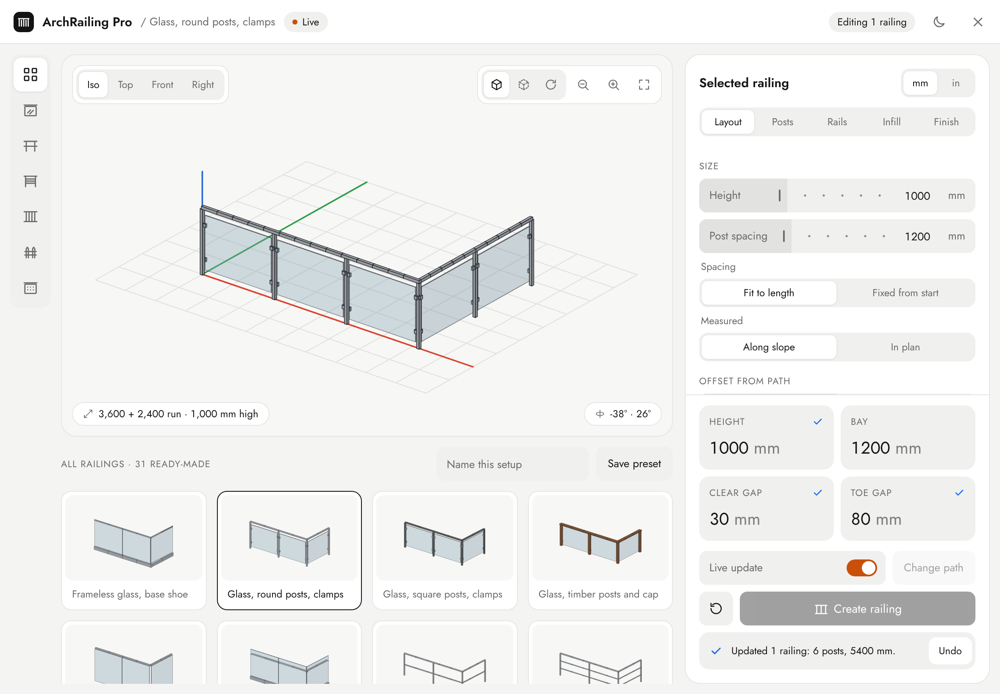
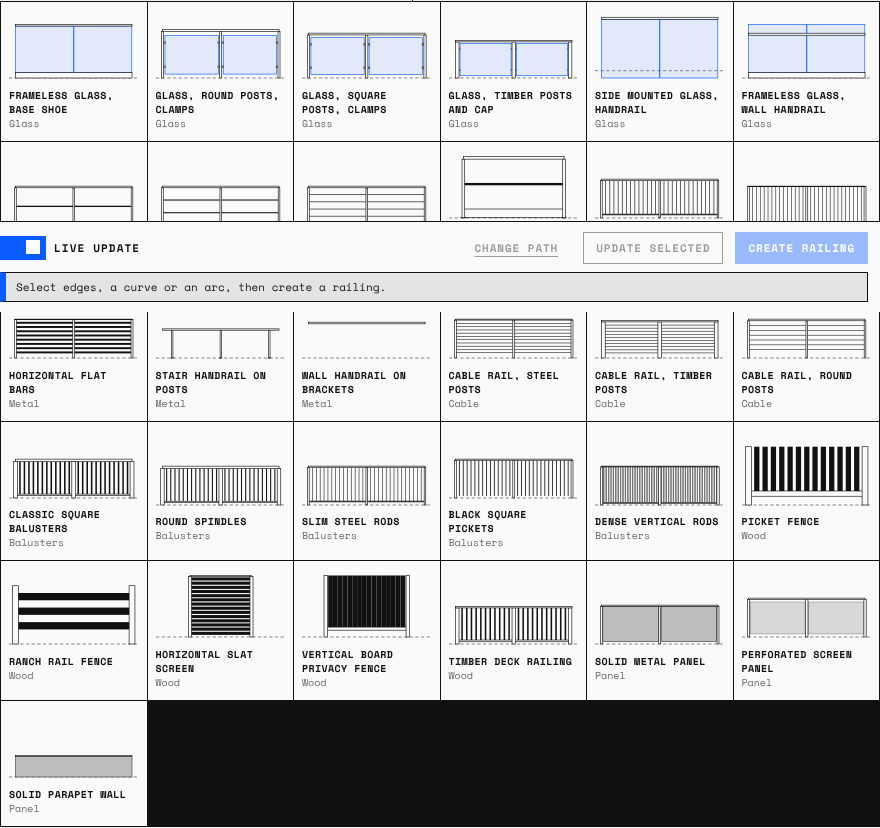

# ArchRailing Pro for SketchUp


Generates railings, balustrades, glass guards and fences along any path you select in SketchUp: edges, arcs, curves, closed loops and stair slopes. Every railing keeps its settings, so you can select it later, change a value and watch it rebuild.

**Download:** [`release/ArchRailingPro_v1.0.0.rbz`](release/ArchRailingPro_v1.0.0.rbz)



The panel has a category rail, a 3D preview you can drag to orbit (Iso, Top, Front and Right views, edges, X-ray, auto-rotate, zoom), the ready-made railings as 3D tiles, and sliders with editable readouts in mm or inches. Four check cards flag height, clear gap and toe gap against common limits (900 mm and 100 mm). These limits aren't a code check: confirm the rules that apply to your project. Light and dark themes follow the system, and a toggle in the header overrides them.

## Install

1. In SketchUp, open **Extensions > Extension Manager**.
2. Click **Install Extension** and choose `ArchRailingPro_v1.0.0.rbz`.
3. Accept the prompt. The **ArchRailing Pro** toolbar and the **Extensions > ArchRailing Pro** menu appear.

Requires SketchUp 2019 or newer (Ruby 2.5+, `UI::HtmlDialog`).

## Use

1. Select the edges of a path: a single line, a chain, an arc, a curve or a closed outline.
2. Open the panel from the toolbar, pick a ready-made railing, and adjust it.
3. Click **Create railing**. You get one group per continuous chain. A junction where three or more edges meet splits the selection into separate railings.
4. To edit, select a railing. The panel switches to **Editing railing** and loads its settings. With **Live update** on, every change rebuilds the selected railings. Each rebuild is one undo step.
5. To move a railing onto a new path, select the railing and the new edges together, then click **Change path**.

**Check it works:** run **Extensions > ArchRailing Pro > Insert gallery of all railings** in an empty model. It builds all 31 railings, each on a run with a stair flight, a landing and a corner. It then reports how long that took, or which railings failed. One undo removes the whole gallery.

**Quick Railing** builds on the selected edges with the last settings you used, without opening the panel.

## How it builds

| Part | Built as |
| --- | --- |
| Posts, balusters, clamps, brackets, base plates | One shared component definition per size, placed with a rotation about Z only, so posts stay plumb and nothing is scaled |
| Top, bottom and horizontal rails, handrails | A swept mesh that follows the path, mitred in plan at every vertex, sloped with the path |
| Glass and panels | A swept mesh per bay, so curved paths get faceted curved glass |

- **Spacing** is measured by arc length along the path, either along the slope or in plan. *Fit to length* divides each run into equal bays no wider than the spacing. *Fixed from start* uses the exact spacing and puts the remainder in the last bay.
- **Corners**: a turn sharper than *Corner post at* (default 20°) gets a post, and each run between corners is spaced on its own. Gentle curves keep spacing continuous through them.
- **Slopes**: a change in pitch larger than *Slope break at* (default 3°) gets a post, so a stair flight and its landing each get their own run. Rails keep their true thickness on the slope.
- **Offsets** move the railing sideways (+ is left of the path direction) or up from the path. An offset larger than a curve's radius is refused with a message.
- **Custom components**: any component in the model can replace the built-in post, baluster or clamp. Its origin is placed at the base centre and its red axis along the path.

Each railing group stores its path (in the group's own coordinates) and settings in the `ArchRailingPro` attribute dictionary, so it rebuilds even after you delete the original edges, and moving or rotating the group is kept.

## The 31 ready-made railings



| Category | Railings |
| --- | --- |
| Glass (6) | Frameless glass on base shoe; glass with round posts and clamps; glass with square posts and clamps; glass with timber posts and cap; side mounted glass with handrail; frameless glass with wall handrail |
| Metal (9) | Steel tube 2 rails; steel tube 3 rails; steel tube 5 rails; industrial pipe with toe board; square tube with square bars; vertical flat bars; horizontal flat bars; stair handrail on posts; wall handrail on brackets |
| Cable (3) | Cable rail on steel posts; on timber posts; on round posts |
| Balusters (5) | Classic square balusters; round spindles; slim steel rods; black square pickets; dense vertical rods |
| Wood (5) | Picket fence; ranch rail fence; horizontal slat screen; vertical board privacy fence; timber deck railing |
| Panel (3) | Solid metal panel; perforated screen panel; solid parapet wall |

**Save preset** stores your own settings next to these.

## Files

```
src/
  arch_railing_pro.rb          loader: registers the SketchupExtension
  arch_railing_pro/
    main.rb                    menus, toolbar, context menu, observers, undo operations
    generator.rb               path parsing, arc-length layout, sweeps, component placement
    ui_dialog.rb               HtmlDialog bridge (JS <-> Ruby callbacks, saved presets)
    defaults.rb                parameter schema, validation, the 31 ready-made railings
    ui/                        dialog.html, dialog.js, tokens.css (Parametric Builder UI v2 look)
    icons/                     toolbar icons (SVG for Windows, PDF for macOS, PNG fallback), logo
test/                          SketchUp API mock and the generator test run
build.sh                       packs src/ into release/*.rbz
```

## Build and test

```
ruby test/run_tests.rb   # builds all 31 railings on 7 path shapes against an API mock
./build.sh               # writes release/ArchRailingPro_v<version>.rbz
```

The test checks every preset on a straight line, an L corner, an arc, a closed square, a closed circle, a stair with landings and a path with duplicate and collinear points. It checks that every swept mesh faces outward, that no triangle is degenerate, the post layouts, the offset mitres, closed-loop seams and the error messages. It also checks the open-group coordinate conversion. It does not run inside SketchUp, so run the gallery command in SketchUp once before sharing the extension.
